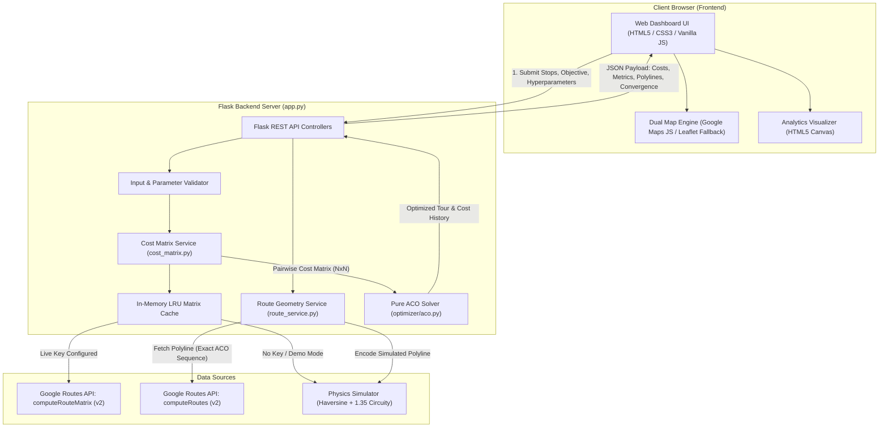

# Smart Shortest Path Finder Using Ant Colony Optimization (ACO) & Google Maps API

[](https://www.python.org/)
[](https://flask.palletsprojects.com/)
[](https://opensource.org/licenses/MIT)
[](tests/)

An engineering web application that optimizes multi-stop travel itineraries using **Ant Colony Optimization (ACO)** and the **Google Routes API (v2)**. Given a fixed starting point, multiple intermediate stops, and a fixed final destination, the application computes an optimal or near-optimal visiting order to minimize either road distance or travel time, providing a comparative analysis against the user's original unoptimized sequence.

---

## Table of Contents
1. [Project Overview](#project-overview)
2. [Key Features](#key-features)
3. [System Architecture](#system-architecture)
4. [Ant Colony Optimization (ACO) Theoretical Framework](#ant-colony-optimization-aco-theoretical-framework)
   - [Problem Formulation (Fixed-Endpoint Open TSP)](#problem-formulation-fixed-endpoint-open-tsp)
   - [Mathematical Equations](#mathematical-equations)
   - [Algorithm Pseudocode](#algorithm-pseudocode)
5. [Dual Operational Modes: Live vs. Demo](#dual-operational-modes-live-vs-demo)
6. [Security & Credential Quarantining](#security--credential-quarantining)
7. [Google Cloud Platform (GCP) Setup Guide](#google-cloud-platform-gcp-setup-guide)
   - [GCP Project Creation & Billing](#1-gcp-project-creation--billing)
   - [Enabling Required APIs](#2-enabling-required-apis)
   - [Generating & Restricting API Keys](#3-generating--restricting-api-keys)
   - [Setting Budget Alerts & Quotas](#4-setting-budget-alerts--quotas)
   - [Billing Warning](#5-billing-warning)
8. [Installation & Quick Start](#installation--quick-start)
9. [Running Automated Tests](#running-automated-tests)
10. [Recorded Empirical Test Results](#recorded-empirical-test-results)
11. [Screenshot Capture Guide](#screenshot-capture-guide)
12. [Git & GitHub Security Publishing Protocol](#git--github-security-publishing-protocol)
13. [Academic Disclaimer](#academic-disclaimer)

---

## Project Overview

In logistics and route planning, traveling between multiple stops without a planned visiting order leads to severe route backtracking, inflated fuel costs, and prolonged transit times. When the start and destination locations are fixed (e.g., departing from a depot and terminating at an airport), finding the best visiting sequence of intermediate stops is known as the **Open Traveling Salesperson Problem (Open TSP) with Fixed Endpoints**.

Because finding the global optimum requires evaluating $M!$ permutations for $M$ intermediate stops (e.g., $10! = 3,628,800$ possible routes), brute-force enumeration is computationally intractable. This project implements **Ant Colony Optimization (ACO)**, a nature-inspired metaheuristic algorithm that models the collective foraging intelligence of biological ant colonies to converge rapidly toward high-quality, near-optimal tours.

---

## Key Features

- **Pure Python ACO Engine**: Developed from first principles in `optimizer/aco.py` with zero dependencies on external routing services.
- **Dual Optimization Objectives**: Selectable between minimizing **Road Distance** (meters) or **Travel Duration** (seconds).
- **Asymmetric Cost Matrix Support**: Correctly accounts for directional differences ($A \to B \neq B \to A$) resulting from one-way streets and traffic congestion.
- **Google Routes API Integration**: Uses Google Compute Route Matrix (v2) for pairwise travel costs and Compute Routes (v2) for geometry polylines.
- **Zero-Key Demo Mode**: Fully functional offline or without billing using physics-based Haversine great-circle distance, an urban circuity multiplier ($1.35$), and city driving models ($35\text{ km/h}$).
- **Interactive Dual-Mode Map**: Seamless fallback to Leaflet & OpenStreetMap if no Google Maps browser key is configured.
- **Visual Baseline vs. ACO Analytics**:
  - Side-by-side comparative metric cards (Distance, Time, Percentage Gain).
  - Side-by-side comparative table with formatted sequence paths.
  - Interactive pure HTML5 Canvas charts (Cost Comparison Bar Chart and Generational Convergence Curve).
  - Dual polylines on the map: Solid blue for ACO vs. Dashed gray for Baseline order with layer toggles.
- **Configurable Hyperparameters**: Sliders for colony size ($m$), generations ($T$), pheromone influence ($\alpha$), heuristic visibility ($\beta$), evaporation rate ($\rho$), deposit constant ($Q$), and random seed.

---

## System Architecture



### Data Flow Pipeline
1. **User Input**: The user adds waypoints via place search, preset benchmark buttons, or clicking directly on the map.
2. **Payload Submission**: A JSON payload specifying stops, optimization objective (`distance` vs. `time`), and ACO parameters is dispatched to `POST /api/optimize`.
3. **Cost Evaluation**: `optimizer/cost_matrix.py` checks the in-memory cache. On a cache miss, it queries Google Routes API `computeRouteMatrix` (or simulates costs via Haversine physics).
4. **ACO Permutation**: `optimizer/aco.py` processes the cost matrix, deploying $m$ artificial ants over $T$ iterations to discover the optimal intermediate stop sequence.
5. **Route Reconstruction**: `optimizer/route_service.py` retrieves the polyline geometry for both the baseline order and the optimized order without Google waypoint reordering.
6. **Rendering**: The client visualizes both paths, re-labels map markers with their updated tour visiting sequence, populates the comparative metrics table, and renders high-DPI HTML5 canvas charts.

---

## Ant Colony Optimization (ACO) Theoretical Framework

### Problem Formulation (Fixed-Endpoint Open TSP)
Let $V = \{0, 1, 2, \dots, N-1\}$ be the set of $N$ locations:
- Stop $0$: Fixed Start point $S$.
- Stop $N-1$: Fixed Destination point $D$.
- $V_{\text{inter}} = \{1, 2, \dots, N-2\}$: Set of $M = N - 2$ intermediate stops to be visited.

Let $C \in \mathbb{R}^{N \times N}$ be the pairwise cost matrix where $C_{ij} \ge 0$ denotes the directed road cost from stop $i$ to stop $j$. The goal is to find a permutation $\pi = (\pi_1, \pi_2, \dots, \pi_M)$ of $V_{\text{inter}}$ that minimizes total path cost:
$$L(\pi) = C_{0, \pi_1} + \sum_{k=1}^{M-1} C_{\pi_k, \pi_{k+1}} + C_{\pi_M, N-1}$$

---

### Mathematical Equations

#### 1. Heuristic Visibility ($\eta_{ij}$)
The visibility represents the local greediness of moving from node $i$ to node $j$ (shorter legs have higher visibility):
$$\eta_{ij} = \frac{1}{\max(C_{ij}, \epsilon)}, \quad \text{where } \epsilon = 10^{-6}$$
This safeguard prevents division by zero when handling co-located stops or zero-cost self-loops.

#### 2. State Transition Probability ($P_{ij}^k$)
For ant $k$ currently at node $i$, the probability of transitioning to unvisited candidate $j \in \text{Allowed}_k$ is:
$$P_{ij}^k = \frac{[\tau_{ij}]^\alpha \cdot [\eta_{ij}]^\beta}{\sum_{l \in \text{Allowed}_k} [\tau_{il}]^\alpha \cdot [\eta_{il}]^\beta}$$
where:
- $\tau_{ij}$ is the current pheromone concentration on directed edge $(i, j)$.
- $\alpha \ge 0$ is the **exploitation parameter** controlling the influence of pheromone history.
- $\beta \ge 0$ is the **exploration parameter** controlling the influence of heuristic distance.
- If the denominator sum underflows to zero, selection defaults to a uniform random distribution over $\text{Allowed}_k$.

#### 3. Pheromone Evaporation
To prevent early stagnation and allow ants to discard suboptimal paths, pheromone evaporates globally across all edges at rate $\rho \in (0, 1)$:
$$\tau_{ij} \leftarrow (1 - \rho) \cdot \tau_{ij}$$
A baseline floor $\tau_{\min} = 10^{-4} \cdot \tau_0$ is enforced to prevent complete pheromone starvation.

#### 4. Pheromone Deposition
Every ant $k$ that completed a tour of total cost $L_k$ deposits pheromone inversely proportional to its tour length:
$$\Delta \tau_{ij}^k = \frac{Q}{\max(L_k, \epsilon)}, \quad \tau_{ij} \leftarrow \tau_{ij} + \sum_{k=1}^m \Delta \tau_{ij}^k$$
where $Q > 0$ is the pheromone scaling constant.

#### 5. Elitist Reinforcement
The best-so-far tour discovered across all iterations receives an additional elitist deposit:
$$\Delta \tau_{ij}^{\text{best}} = w_e \cdot \frac{Q}{\max(L_{\text{best}}, \epsilon)}$$
where $w_e \ge 0$ is the elitist weight (default: $1.0$).

#### 6. Percentage Improvement Formula
To evaluate efficiency gains against the user's original unoptimized sequence:
$$\text{Improvement } \% = \begin{cases} 0.0 & \text{if } \text{Cost}_{\text{baseline}} \le 0 \\ \left(\frac{\text{Cost}_{\text{baseline}} - \text{Cost}_{\text{optimized}}}{\text{Cost}_{\text{baseline}}}\right) \times 100 & \text{otherwise} \end{cases}$$

---

### Algorithm Pseudocode

```text
Algorithm: Ant Colony Optimization for Open TSP with Fixed Endpoints
Input: Square Cost Matrix C (NxN), m (ants), T (iterations), alpha, beta, rho, Q, seed
Output: Best Tour, Best Cost, Iteration History

1.  Validate matrix C (ensure N >= 2, non-negative, finite numbers).
2.  Initialize baseline tour = [0, 1, 2, ..., N-1] and calculate baseline cost L_baseline.
3.  Compute heuristic matrix eta_ij = 1 / max(C_ij, 1e-6) for all i != j.
4.  Initialize pheromone matrix tau_ij = Q / max(L_baseline, 1.0).
5.  Set best_tour = baseline_tour, best_cost = L_baseline.
6.  Set iteration_history = [].

7.  FOR iteration = 1 TO T DO:
8.      iteration_tours = []
9.      FOR ant = 1 TO m DO:
10.         tour = [0]                 // Start at fixed start point
11.         current = 0
12.         allowed = {1, 2, ..., N-2} // Intermediate stops
13.         WHILE allowed is not empty DO:
14.             FOR each j in allowed DO:
15.                 attractiveness[j] = (tau[current, j]^alpha) * (eta[current, j]^beta)
16.             END FOR
17.             Normalize attractiveness into probabilities P[j]
18.             Select next node j probabilistically according to P[j]
19.             Append j to tour, remove j from allowed, set current = j
20.         END WHILE
21.         Append N-1 to tour         // Terminate at fixed destination
22.         Calculate cost L = sum of C[tour[k], tour[k+1]]
23.         iteration_tours.append((tour, L))
24.         IF L < best_cost THEN:
25.             best_cost = L
26.             best_tour = tour
27.         END IF
28.     END FOR
29.     // Evaporation
30.     tau_ij = max((1 - rho) * tau_ij, tau_min) for all i, j
31.     // Deposition
32.     FOR each (tour, L) in iteration_tours DO:
33.         deposit = Q / max(L, 1e-6)
34.         FOR each consecutive edge (u, v) in tour DO:
35.             tau[u, v] = tau[u, v] + deposit
36.         END FOR
37.     END FOR
38.     // Elitist boost
39.     FOR each consecutive edge (u, v) in best_tour DO:
40.         tau[u, v] = tau[u, v] + (Q / max(best_cost, 1e-6))
41.     END FOR
42.     Record best_cost in iteration_history
43. END FOR

44. Calculate improvement % = ((L_baseline - best_cost) / L_baseline) * 100
45. Return best_tour, best_cost, baseline_cost, improvement %, iteration_history
```

---

## Dual Operational Modes: Live vs. Demo

| Feature | Simulated Demo Mode | Live Google Maps Mode |
| :--- | :--- | :--- |
| **API Keys Required** | **None** (zero setup needed) | Browser Key + Server Key |
| **Google Cloud Billing** | **Not Required** ($0.00 cost) | Required on GCP Account |
| **Data Label in UI** | `SIMULATED DATA (DEMO MODE)` (Amber) | `LIVE GOOGLE DATA` (Emerald) |
| **Cost Matrix Calculation** | Haversine Formula $\times 1.35$ Circuity Factor | Google Compute Route Matrix (v2) |
| **Driving Duration** | Urban Velocity Model ($35\text{ km/h} \approx 9.72\text{ m/s}$) | Real-time traffic-aware Google Routes API |
| **Route Geometry** | Standard 5-decimal encoded polyline | Google Compute Routes (v2) polyline |
| **Map Rendering** | Leaflet with OpenStreetMap vector tiles | Google Maps JavaScript API |
| **Caching** | In-memory coordinate hash cache | In-memory coordinate hash cache |

---

## Security & Credential Quarantining

Hard Rule 5 strictly dictates that private API keys must never reach client-side JavaScript:

1. **Quarantined Server Key (`GOOGLE_MAPS_SERVER_API_KEY`)**:
   - Stored in local `.env` and loaded exclusively by Python backend modules (`app.py`, `optimizer/cost_matrix.py`, `optimizer/route_service.py`).
   - Never referenced in Jinja2 templates, frontend scripts, or API JSON responses.
2. **Restricted Browser Key (`GOOGLE_MAPS_BROWSER_API_KEY`)**:
   - Only used for frontend map rendering and Google Places Autocomplete.
   - Restrictable in GCP to HTTP Referrers (e.g. `http://localhost:5000/*`).
3. **Repository Protection**:
   - The `.gitignore` file excludes `.env`, `*.env`, `venv/`, and `__pycache__/`.
   - `.env.example` contains placeholders only and is the only environment template committed to Git.

---

## Google Cloud Platform (GCP) Setup Guide

To transition from Demo Mode to Live Mode:

### 1. GCP Project Creation & Billing
1. Navigate to the [Google Cloud Console](https://console.cloud.google.com/).
2. Create a new project: Click **Select a Project** $\to$ **New Project**, name it `smart-route-optimizer`, and click **Create**.
3. Link a Billing Account: Under **Billing**, link a credit card or debit card. Google Cloud provides a $300 free trial credit for new accounts plus a monthly free usage tier.

### 2. Enabling Required APIs
Under **APIs & Services** $\to$ **Library**, search for and enable the following three APIs:
1. **Maps JavaScript API** (for interactive map display in the browser)
2. **Places API (New)** (for place search and address autocomplete)
3. **Routes API** (for backend pairwise matrix and polyline calculations)

### 3. Generating & Restricting API Keys
Create two separate keys under **APIs & Services** $\to$ **Credentials**:

#### Key A: Browser API Key
- Click **Create Credentials** $\to$ **API Key**. Rename it to `Browser Maps Key`.
- Under **Set application restrictions**, choose **Websites (HTTP referrers)**.
- Under **Website restrictions**, add:
  - `http://localhost:5000/*`
  - `http://127.0.0.1:5000/*`
- Under **API restrictions**, choose **Restrict key** and select:
  - *Maps JavaScript API*
  - *Places API*
- Copy this key to `GOOGLE_MAPS_BROWSER_API_KEY` in your `.env`.

#### Key B: Server API Key
- Click **Create Credentials** $\to$ **API Key**. Rename it to `Server Routes Key`.
- Under **Set application restrictions**, choose **IP addresses** (for a dedicated production server) or **None** (for local development).
- Under **API restrictions**, choose **Restrict key** and select:
  - *Routes API*
- Copy this key to `GOOGLE_MAPS_SERVER_API_KEY` in your `.env`.

### 4. Setting Budget Alerts & Quotas
To prevent unexpected billing:
1. Go to **Billing** $\to$ **Budgets & Alerts** $\to$ **Create Budget**. Set a budget amount of **$5.00** and check email alert triggers at 50%, 90%, and 100%.
2. Go to **APIs & Services** $\to$ **Routes API** $\to$ **Quotas**. Set a hard daily cap of **100 requests/day** for `Compute Route Matrix` and `Compute Routes`.

### 5. Billing Warning
> [!WARNING]
> **Live Google Maps API usage may incur charges.**
> Always monitor your GCP billing console. If your free monthly quota is exceeded or billing is disabled, the app gracefully continues operating using **Demo Mode**.

---

## Installation & Quick Start

### Prerequisites
- Python 3.10 or higher
- PowerShell (Windows) or Terminal (macOS/Linux)
- Git

### Step-by-Step Setup

```powershell
# 1. Clone the repository
git clone https://github.com/your-username/smart-route-optimizer.git
cd smart-route-optimizer

# 2. Create and activate a Python virtual environment
python -m venv venv
.\venv\Scripts\Activate.ps1   # On Linux/macOS: source venv/bin/activate

# 3. Install pinned dependencies
python -m pip install -r requirements.txt

# 4. Create your local .env file from the template
Copy-Item .env.example .env    # On Linux/macOS: cp .env.example .env
```

Open `.env` in a text editor:
```env
GOOGLE_MAPS_BROWSER_API_KEY=your_browser_key_here
GOOGLE_MAPS_SERVER_API_KEY=your_server_key_here
FLASK_SECRET_KEY=generate_a_random_secret_string
FLASK_PORT=5000
```
*(Leave keys empty to run in zero-cost Demo Mode!)*

```powershell
# 5. Launch the Flask application
python app.py
```
Open **`http://localhost:5000`** in your browser.

---

## Running Automated Tests

All tests run locally without calling live Google APIs by using mocks and the physics simulation engine:

```powershell
# Run the complete test suite (56 tests)
pytest -v

# Run with test coverage report
pytest --cov=optimizer --cov=app -v
```

### Verified Test Breakdown
- **`tests/test_aco.py` (28 tests)**: Validates cost matrix requirements, negative cost rejection, degenerate cases ($N=2, N=3$), zero-cost co-located stops, hyperparameter boundary validation, pheromone evaporation/deposit math, elitist reinforcement, asymmetric cost handling, and deterministic seed reproducibility.
- **`tests/test_cost_matrix.py` (13 tests)**: Validates Haversine distance math against real coordinates, simulated matrix generation, mocked Google Routes API response parsing, Google error handling ($400, 403, 500, \text{ROUTE\_NOT\_FOUND}$), polyline compression, and LRU cache hits.
- **`tests/test_app.py` (14 tests)**: Validates REST API responses, input schemas, coordinate range checks ($-90 \le \text{lat} \le 90$), objective toggles (`distance` vs. `time`), DOM element regressions, and error codes ($400, 404, 405$).
- **`tests/smoke_test.py` (1 test)**: End-to-end integration pipeline verification.

---

## Recorded Empirical Test Results

Empirical results measured across 4 standardized benchmark scenarios using 20 ants over 40 iterations:

| Scenario / Benchmark | Stops Count ($N$) | Original User Order | ACO Discovered Order | Baseline Cost | ACO Cost | Absolute Savings | Efficiency Gain (%) |
| :--- | :---: | :--- | :--- | :--- | :--- | :--- | :---: |
| **Linear Benchmark (Zigzag)** | 5 | `S → 1 → 2 → 3 → D` | `S → 2 → 1 → 3 → D` | 90.0 km | 50.0 km | 40.0 km | **44.44%** |
| **Bangalore Tech Hubs** | 5 | `S → 1 → 2 → 3 → D` | `S → 2 → 3 → 1 → D` | 67.7 km | 55.4 km | 12.3 km | **18.14%** |
| **New York Landmarks** | 6 | `S → 1 → 2 → 3 → 4 → D` | `S → 2 → 1 → 3 → 4 → D` | 18.4 km | 14.8 km | 3.6 km | **19.57%** |
| **Central London Sights** | 5 | `S → 1 → 2 → 3 → D` | `S → 1 → 3 → 2 → D` | 16.9 km | 14.1 km | 2.8 km | **16.57%** |

*Note: Results were measured under identical coordinate inputs and cost functions.*

---

## Screenshot Capture Guide

When preparing presentations or viva documents, capture these 4 views:
1. **Initial Dashboard State**: Show the split view with the map, waypoint list, and the amber `SIMULATED DATA (DEMO MODE)` badge.
2. **Dual-Polyline Route Map**: Run optimization on **Bangalore Tech Hubs** to display the bold blue optimized route contrasted against the dashed gray baseline route.
3. **Comparative Table & Bar Chart**: Scroll to the Results Panel showing the side-by-side metric comparison and the Bar Chart.
4. **ACO Convergence Curve**: Click the **Convergence Curve** tab to capture the generational cost reduction line chart showing algorithm convergence.

---

## Git & GitHub Security Publishing Protocol

Follow this checklist to publish your project without leaking private keys:

```powershell
# Step 1: Verify .gitignore is tracking .env
git status --ignored
# Confirm that .env appears under "Ignored files" and NOT under "Changes to be committed"

# Step 2: Initialize Git and stage tracked project files
git init
git add .

# Step 3: Verify no .env or secrets are staged
git status
# If .env is listed, DO NOT commit! Run: git rm --cached .env

# Step 4: Commit your project
git commit -m "feat: complete Smart Route Optimizer with ACO and Google Routes API"

# Step 5: Link your remote repository and push
git remote add origin https://github.com/your-username/smart-route-optimizer.git
git branch -M main
git push -u origin main
```

---

## Academic Disclaimer

> **Scientific & Academic Note**: Ant Colony Optimization (ACO) is a nature-inspired metaheuristic algorithm. It searches the discrete pairwise cost matrix of selected waypoints to discover high-quality, near-optimal paths. It does not mathematically guarantee the global theoretical minimum, nor does it reorder individual turn-by-turn road junctions between two fixed waypoints. Percentage improvement is calculated using the formula:
> $$\text{Improvement } \% = \frac{\text{Baseline Cost} - \text{Optimized Cost}}{\text{Baseline Cost}} \times 100$$
