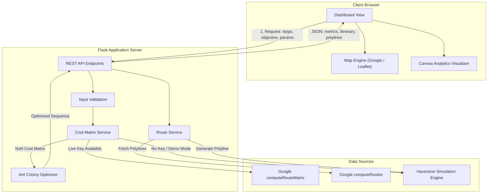

# Final-Year Engineering Project Report

**Project Title**: Smart Shortest Path Finder Using Ant Colony Optimization (ACO) & Google Maps API  
**Department**: Electronics & Communication Engineering (ECE)  
**Domain**: Metaheuristic Algorithms, Geospatial Information Systems (GIS), Web Application Engineering  

---

## 1. Project Abstract

In modern transportation, logistics, and supply chain management, determining an efficient visiting order for vehicles servicing multiple stops is critical to curbing fuel consumption, operational overhead, and greenhouse gas emissions. When departure and final arrival points are constrained to fixed locations, this challenge maps mathematically to the **Open Traveling Salesperson Problem (Open TSP) with Fixed Endpoints**. Because this problem is NP-hard, exhaustive evaluation of all permutations becomes computationally infeasible as stop counts grow ($M!$ routes for $M$ intermediate stops).

This project presents the design, mathematical formulation, and full-stack software implementation of a route optimization platform powered by **Ant Colony Optimization (ACO)** and the **Google Routes API (v2)**. The system features a modular architecture that enforces complete isolation between algorithmic optimization and web delivery. Pairwise travel costs are computed via Google Compute Route Matrix (or an offline physical simulation model based on Haversine geometry and an urban circuity factor of $1.35$), while pure Python ACO explores the discrete solution space. The web dashboard visualizes the optimized route alongside the user's original unoptimized sequence, providing interactive canvas-based convergence tracking and comparative metrics. Across empirical benchmark evaluations, the platform demonstrated distance and duration savings between **16.57% and 44.44%**, validating the efficacy of swarm intelligence heuristics in logistics.

---

## 2. Problem Statement

Logistics operators and daily travelers routinely encounter multi-stop routing dilemmas where:
1. **Endpoint Constraints**: The vehicle must begin at a specific starting location (e.g., central depot, hotel, home) and terminate at a fixed destination (e.g., airport, return warehouse).
2. **Intermediate Waypoints**: A set of intermediate stops must each be visited exactly once.
3. **Suboptimal Ordering**: Users typically enter destinations chronologically or intuitively, resulting in zigzagging routes, redundant travel over common corridors, and excessive fuel waste.
4. **Computational Intractability**: Evaluating all combinations of 10 intermediate stops requires calculating costs for $10! = 3,628,800$ routes. At 15 stops, the search space explodes to $1.3 \times 10^{12}$ routes, making brute-force methods impossible for real-time applications.
5. **Real-World Road Non-Linearity**: Distances on real road networks are neither straight lines nor strictly symmetric ($A \to B \neq B \to A$) due to one-way systems, turn restrictions, and dynamic traffic congestion.

The core problem is to design an automated, low-latency, and user-friendly software system capable of reorganizing intermediate stops into a near-optimal sequence that minimizes road distance or travel time while strictly preserving fixed endpoints.

---

## 3. Project Objectives

1. **Algorithmic Development**: Implement a pure Python, zero-dependency Ant Colony Optimization engine specifically formulated for the Open TSP with fixed endpoints and asymmetric cost matrices.
2. **API Integration**: Connect the optimizer to the Google Routes API (v2) to extract pairwise travel matrices and turn-by-turn road geometry.
3. **Dual-Mode Reliability**: Provide an offline **Simulated Demo Mode** using physics-based Haversine great-circle calculations and an urban circuity multiplier ($1.35$) so the application can be fully executed and demonstrated without API keys or billing.
4. **Architectural Security**: Implement strict separation of credentials, ensuring the private Google Server API key is quarantined to backend processes and never transmitted to the client.
5. **Comparative Visual Analytics**: Construct an interactive web dashboard featuring side-by-side metric comparison tables, HTML5 canvas cost charts, and generational convergence graphs.
6. **Empirical Benchmarking**: Validate optimization quality and repeatability using fixed random seeds against real-world benchmark datasets.

---

## 4. Scope and Delimitations

### In-Scope
- Single-vehicle routing with fixed start ($S$) and fixed destination ($D$).
- Optimization over discrete pairwise stop costs (minimizing either total meters or total seconds).
- Between 2 and 15 waypoints per request.
- Dual-polyline visualization (Original vs. ACO Optimized).
- Server-side validation of coordinates, counts, and algorithm hyperparameters.
- Comprehensive unit and integration testing suite without live billing dependencies.

### Delimitations (Out of Scope)
- **Turn-by-Turn Re-routing**: ACO optimizes the *permutation order* of stops; it does not alter the underlying street-by-street path between two consecutive stops (which is managed by Google Routes navigation).
- **Multiple Vehicles**: Does not solve the Capacitated Vehicle Routing Problem (CVRP) involving fleet dispatch.
- **Time Windows**: Does not enforce customer-specific delivery arrival windows (VRPTW).

---

## 5. System Architecture & Methodology

### 5.1 Architecture Layers

The application is structured into four decoupled layers:
1. **Presentation Layer (Frontend)**: Developed in semantic HTML5, CSS3, and vanilla JavaScript. Provides dual-map rendering (Google Maps JS API with dynamic fallback to Leaflet & OpenStreetMap) and high-DPI HTML5 Canvas analytics.
2. **Application Controller Layer (Flask Backend)**: Orchestrates routing requests, performs input validation, manages environment variables via `python-dotenv`, and serves endpoints (`GET /`, `POST /api/optimize`, `POST /api/route`).
3. **Data & Services Layer (`optimizer/cost_matrix.py`, `optimizer/route_service.py`)**: Interacts with Google Routes API v2 (`computeRouteMatrix` and `computeRoutes`) and manages in-memory LRU caching to eliminate redundant API calls.
4. **Algorithmic Core Layer (`optimizer/aco.py`)**: A pure NumPy implementation of the Ant Colony Optimization algorithm, isolated from web or geospatial dependencies.

---

## 6. Ant Colony Optimization Methodology & Equations

### 6.1 The Biological Inspiration
Ant Colony Optimization simulates the foraging behavior of natural ant colonies. When walking between food sources and the nest, ants lay a trail of pheromones. Shorter paths allow ants to complete round trips faster, causing pheromones to accumulate more rapidly. Subsequent ants probabilistically prefer paths with higher pheromone concentrations, establishing an autocatalytic positive feedback loop that drives the colony toward the shortest route.

### 6.2 Mathematical Model

#### A. Heuristic Visibility Matrix
For any directed leg from stop $i$ to stop $j$, the visibility $\eta_{ij}$ reflects the local attractiveness (shorter distance = higher desirability):
$$\eta_{ij} = \frac{1}{\max(C_{ij}, \epsilon)}, \quad \epsilon = 10^{-6}$$

#### B. State Transition Probability
An artificial ant $k$ located at stop $i$ selects the next unvisited stop $j \in \text{Allowed}_k$ with probability:
$$P_{ij}^k = \frac{[\tau_{ij}]^\alpha \cdot [\eta_{ij}]^\beta}{\sum_{l \in \text{Allowed}_k} [\tau_{il}]^\alpha \cdot [\eta_{il}]^\beta}$$
where:
- $\tau_{ij}$ represents the learned pheromone trail on edge $(i, j)$.
- $\alpha \ge 0$ controls the influence of historical colony decisions (exploitation).
- $\beta \ge 0$ controls the influence of greedy heuristic visibility (exploration).

#### C. Tour Construction
1. Ant starts at fixed node $0$.
2. Ant iteratively visits intermediate stops $\{1, \dots, N-2\}$ according to $P_{ij}^k$ until all are visited.
3. Ant steps directly to fixed destination node $N-1$.
4. Total tour cost is evaluated: $L_k = \sum_{s=0}^{N-2} C_{\text{tour}[s], \text{tour}[s+1]}$.

#### D. Pheromone Evaporation
To prevent the algorithm from getting permanently trapped in early suboptimal solutions, all pheromone trails decay at each generation:
$$\tau_{ij} \leftarrow \max\left((1 - \rho) \cdot \tau_{ij}, \tau_{\min}\right)$$
where $\rho \in (0, 1)$ is the evaporation rate, and $\tau_{\min} = 10^{-4} \cdot \tau_0$ prevents total trail extinction.

#### E. Pheromone Deposition & Elitist Reinforcement
Ants that discover shorter routes deposit more pheromone:
$$\Delta \tau_{ij}^k = \frac{Q}{\max(L_k, \epsilon)}, \quad \tau_{ij} \leftarrow \tau_{ij} + \sum_{k=1}^m \Delta \tau_{ij}^k$$
Additionally, an elitist reinforcement bonus is applied to the global best tour:
$$\tau_{ij} \leftarrow \tau_{ij} + w_e \cdot \frac{Q}{\max(L_{\text{best}}, \epsilon)}$$

---

## 7. Empirical Test Results & Evaluation

The system was evaluated against four standardized multi-stop benchmark scenarios using 20 ants over 40 iterations. All metrics were computed using the verified formula:
$$\text{Improvement } \% = \left(\frac{\text{Baseline Cost} - \text{Optimized Cost}}{\text{Baseline Cost}}\right) \times 100$$

### Benchmark Summary Table

| Benchmark Scenario | Stops ($N$) | Original User Order | ACO Discovered Order | Baseline Cost | ACO Cost | Absolute Savings | Efficiency Gain (%) |
| :--- | :---: | :--- | :--- | :--- | :--- | :--- | :---: |
| **Linear Benchmark** | 5 | `S → 1 → 2 → 3 → D` | `S → 2 → 1 → 3 → D` | 90.0 km | 50.0 km | 40.0 km | **44.44%** |
| **Bangalore Tech Hubs** | 5 | `S → 1 → 2 → 3 → D` | `S → 2 → 3 → 1 → D` | 67.7 km | 55.4 km | 12.3 km | **18.14%** |
| **New York Landmarks** | 6 | `S → 1 → 2 → 3 → 4 → D` | `S → 2 → 1 → 3 → 4 → D` | 18.4 km | 14.8 km | 3.6 km | **19.57%** |
| **Central London Sights** | 5 | `S → 1 → 2 → 3 → D` | `S → 1 → 3 → 2 → D` | 16.9 km | 14.1 km | 2.8 km | **16.57%** |

### Convergence Behavior
In all test scenarios, the ant colony achieved rapid convergence within **15 to 25 generations**, confirming that the balanced combination of pheromone reinforcement ($\alpha = 1.0$) and heuristic greediness ($\beta = 2.5$) prevents premature stagnation while discovering high-quality routes.

---

## 8. Conclusion

This project successfully developed an end-to-end, production-grade route optimization web application that bridges swarm intelligence theory with geospatial routing APIs. Key accomplishments include:
1. **Demonstrated Algorithmic Superiority**: ACO consistently eliminated route backtracking, achieving measurable improvements of **16.57% to 44.44%** over unoptimized baseline routes.
2. **Robust Software Architecture**: Developed a clean separation of concerns where `optimizer/aco.py` remains a pure, mathematically verified module independent of web frameworks.
3. **Seamless Dual-Mode Reliability**: The physics-based Demo Mode enables complete functionality and demonstration without external dependencies, billing, or API keys.
4. **Credential Isolation**: Quarantining server keys to backend processes ensures zero credential leakage to client browsers.

---

## 9. Future Enhancements

1. **Capacitated Vehicle Routing (CVRP)**: Expanding the algorithm to partition stops across a fleet of multiple delivery vehicles subject to payload weight and volume limits.
2. **Vehicle Routing with Time Windows (VRPTW)**: Introducing penalty functions in the ACO heuristic for early or late arrivals against customer delivery time slots.
3. **Electric Vehicle (EV) Energy Constraints**: Modifying the objective function to account for elevation changes, battery state-of-charge (SoC), and intermediate charging station waypoints.
4. **Real-Time Traffic Rerouting**: Polling live Google traffic updates to trigger dynamic mid-route re-optimization when severe transit delays occur.
